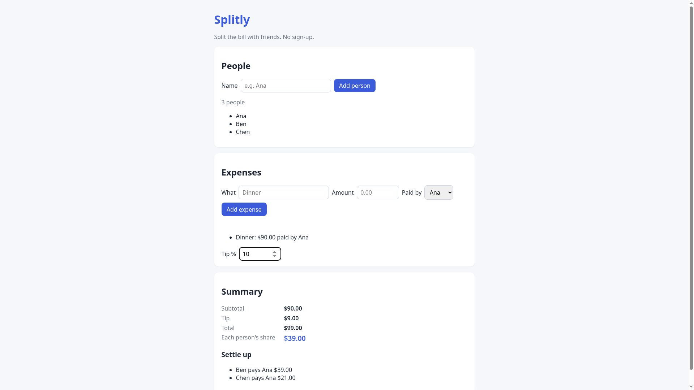

# kane-loop

**A verification loop between your coding agent and [Kane CLI](https://github.com/LambdaTest/kane-cli).**
You change code; kane-loop works out which saved Kane flows the change can break, replays
only those in a real headless Chrome, and when one fails it writes a hand-off file that a coding
agent can act on: the failing step, the value Kane expected, the value it saw, Kane's own triage,
the hunk of your diff that triggered the run, and the evidence. The agent fixes the code and
calls `rerun_failed`, and the loop closes when Kane replays the flow green.

It works from the terminal (`verify`, `watch`, a pre-commit hook, CI), and as an **MCP server**
that Cursor, Claude Code, Codex or any other MCP host can call. No dependencies besides Node 18+ and kane-cli.

> Demo video (2 min): `<VIDEO_URL>` (also in [`demo/kane-loop-demo.mp4`](demo/kane-loop-demo.mp4))



## Try it in 30 seconds

```bash
git clone <REPO_URL> kane-loop && cd kane-loop
npm run app                  # Splitly, the demo app: http://localhost:4173
```

Then let Kane verify it (needs `npm i -g @testmuai/kane-cli` and either `kane-cli login` or
`LT_USERNAME` / `LT_ACCESS_KEY` in the environment):

```bash
npm run verify:all           # replays the 3 saved flows headless; starts the app itself if it is not running
```

And the regression from the video:

```bash
git apply demo/regression.patch   # the "refactor" that breaks the tip split
npm test                          # unit tests: still green
node bin/kane-loop.js verify      # Kane: tip_split fails at step 2, settle_up passes, add_people is skipped
node bin/kane-loop.js last-failure
git apply -R demo/regression.patch && node bin/kane-loop.js rerun-failed   # green again
```

Replays of recorded steps cost 0 credits. Kane's automatic triage of a failed replay costs about 1 credit.

## What is in the box

| Path | What it is |
|---|---|
| `demo-app/` | **Splitly**, a small split-the-bill web app (people, expenses, tip, settle-up). Plain HTML/JS, no build step |
| `flows/*_test.md` | Three Kane flows: add people, even split with a tip, settle-up after two payers. Each has a `<!-- kane-loop covers: ... -->` comment |
| `flows/output-*/` | Kane's recordings of those flows (committed, as the Kane docs recommend), so replays are fast, free and deterministic |
| `bin/kane-loop.js`, `src/` | The tool: diff mapping, kane-cli runner and NDJSON parser, report writer, MCP server, watcher |
| `AGENTS.md`, `.cursor/mcp.json`, `.mcp.json` | What a coding agent in this repo should do, and the MCP registration for Cursor and Claude Code |
| `scripts/pre-commit`, `.github/workflows/kane-loop.yml` | A git hook that blocks a commit when a covered flow fails, and an example CI job |
| `docs/real-runs/` | Output saved from real runs: the failure report, Kane's screenshots, watch-mode and pre-commit logs |
| `demo/` | The video, the real terminal captures it is rendered from, the regression patch |
| `test/` | 16 tests (`npm test`), using NDJSON captured from real kane-cli 0.10.3 runs |

## How it uses Kane CLI

```
agent edits code ──► kane-loop verify | watch | pre-commit | MCP verify_changed
                       │  git diff (vs HEAD or --base) ∩ each flow's "covers" globs
                       ▼
   kane-cli testmd run flows/<x>_test.md --agent --headless --no-adaptive-heal --timeout 300
                       │  (auth: --username/--access-key from LT_* env vars, or your kane-cli login)
                       ▼
   NDJSON stream ──► one kane_loop_summary line on stdout + .kane/last-failure.md + .kane/last-run.json
                       ▼
   MCP last_failure ──► agent fixes the app ──► MCP rerun_failed ──► green (or the next report)
```

- **Diff → flows.** kane-cli rejects unknown frontmatter keys, so a flow declares what it covers in
  an HTML comment before its first `##` step. kane-cli ignores that part of the file, so the comment
  never changes a step hash or forces a re-author:
  `<!-- kane-loop covers: demo-app/public/split.js demo-app/public/app.js -->`.
  A flow is replayed when its own file changed or a changed file matches one of its globs. A flow
  with no `covers` is replayed for any change. Kane's artifacts (`output-*`, `.testmuai/`, `.kane/`)
  and the `ignore` globs in `kane-loop.json` never trigger a run. A flow that failed stays selected
  until Kane replays it green, even after the diff goes away.
- **Replay, not re-author.** Each selected flow runs with `kane-cli testmd run --agent --headless`.
  Recorded steps replay in about 7 seconds for 0 credits. kane-loop passes `--no-adaptive-heal` by
  default: when the app is wrong, a replay that quietly re-authors itself around the change hides
  the bug and spends credits. `--heal` turns healing back on for a run.
- **Reading the stream.** kane-loop follows `test_md_step_start` / `test_md_step_end` for the step
  that failed, `run_start` for its objective, `step_end` for the failing action, `run_end` for
  `reason`, `variables_out` (the values Kane read on the page), `verdict` (Kane's triage) and the
  screenshot path, `test_md_bug_verdict`, `test_md_summary` (replay vs author decisions) and
  `test_md_done`. It reads the exit code first: `2` means Kane did not start, which is reported as
  "did not start", never as a test failure.
- **Expected vs seen, without a model.** When Kane authored a step it recorded every check as an
  `analyze` action with a key and an `expected_value` (in `output-<flow>/.internal/steps/`). On
  replay the same keys come back in `run_end.variables_out` with what is on the page now.
  kane-loop joins the two: `Each person's share: expected $33.00, seen $39.00`.
- **Evidence.** The report links Kane's screenshot of the failing step (copied to `.kane/`) and the
  sealed evidence pack in `.testmuai/evidence/` (`kane-cli evidence serve <pack>` opens it).
- **One-off checks.** `kane-loop check "<objective>"` and MCP `verify_flow {objective}` run
  `kane-cli run --agent --headless --url <app> --max-steps 20` for things no flow covers yet. These
  cost credits; the tool descriptions say so, so agents use them deliberately.

## How an agent closes the loop

Register the MCP server (already done for this repo in `.cursor/mcp.json` and `.mcp.json`):

```json
{ "mcpServers": { "kane-loop": { "command": "node", "args": ["bin/kane-loop.js", "mcp"] } } }
```

Codex CLI (`~/.codex/config.toml`):

```toml
[mcp_servers.kane-loop]
command = "node"
args = ["/path/to/kane-loop/bin/kane-loop.js", "mcp"]
```

Tools:

| Tool | What it does | Credits |
|---|---|---|
| `verify_changed {base?}` | Replay every flow the current diff affects. Returns the summary and, on failure, the full report | 0 for replays |
| `verify_flow {testmd}` / `{objective, url?}` | Replay one saved flow, or run a one-off natural-language check | 0 / about 20 |
| `last_failure {}` | Return `.kane/last-failure.md` | 0 |
| `rerun_failed {}` | Replay only the flows that failed last time | 0 |
| `list_flows {base?}` | Which flows the diff would replay (no browser) | 0 |

`AGENTS.md` tells any agent the rules: verify after changing code, read the report, fix the
**app** and not the `_test.md` (unless the requirement changed), re-run until green.
Agents without MCP use the same loop through the CLI: `kane-loop verify` exits `1` and prints the
summary, the agent reads `.kane/last-failure.md`, fixes the code, and runs `kane-loop rerun-failed`.
For a hook on every save there is `kane-loop watch`, and `scripts/pre-commit` blocks the commit.

`node scripts/mcp-call.mjs <tool> [json]` is a 30-line MCP client that sends the same JSON-RPC an
MCP host sends (it is what the video uses). `test/mcp.test.js` drives the whole loop over MCP
(verify_changed → last_failure → fix → rerun_failed) against a stand-in kane-cli that replays
NDJSON captured from real runs.

## What the hand-off looks like

A real one, from [`docs/real-runs/last-failure-tip_split.md`](docs/real-runs/last-failure-tip_split.md) (shortened):

```markdown
# Kane caught a failure in `flows/tip_split_test.md`
- Failing step: 2 of 3: "Add a 10% tip"
- Kane reason: `assertion_failed: @ step 4`
## Expected vs seen
| Total shows "$99.00".               | $99.00 | $99.00 | ✓ |
| Each person's share shows "$33.00". | $33.00 | $39.00 | ❌ |
## Kane's triage (application_issue/ui_data_defect, severity major, confidence 0.99)
## Likely culprit: the change that triggered this replay
-  const base = Math.floor(total / n);
+  const base = Math.floor(subtotal / n) + tip;
## Evidence
- Screenshot at the failing step: `.kane/failure-tip_split.png`
- Evidence pack: `.testmuai/evidence/<id>.evidence`
## Next
1. Fix the application code ...  2. Re-run: `kane-loop rerun-failed` (MCP: `rerun_failed`)
```

`kane-loop verify` prints one line of NDJSON on stdout (progress goes to stderr):

```json
{"type":"kane_loop_summary","status":"failed","base":"HEAD","changed":["demo-app/public/split.js"],
 "flows":[{"flow":"flows/settle_up_test.md","status":"passed","replayed":3,"credits":0,"session_id":"13f2f862-…"},
          {"flow":"flows/tip_split_test.md","status":"failed","failed_step":{"index":2,"heading":"Add a 10% tip"},
           "expected_vs_seen":[{"check":"Each person's share shows \"$33.00\".","expected":"$33.00","seen":"$39.00"}],
           "kane_triage":"With three people, a $99.00 total is shown correctly but the displayed share is $39.00 instead of $33.00.",
           "session_id":"d6599835-…","credits":0.72}],
 "skipped":[{"flow":"flows/add_people_test.md","reason":"no changed file is covered by this flow"}],
 "credits":0.72,"last_failure":".kane/last-failure.md"}
```

Exit codes: `0` passed or nothing to verify, `1` a flow failed, `2` Kane or the app did not start.

## Real results (kane-cli 0.10.3, 12 Nov 2026, local headless Chrome against http://localhost:4173)

Kane runs locally in Chrome, so the app on `localhost` is reachable without a tunnel.

| What | Kane session | Result | Credits |
|---|---|---|---|
| Author `tip_split` (first `kane-cli testmd run`) | `88a52c04-8378-4a60-94ac-23f9ed145cd9` | passed, 3 steps authored, 86 s | 48 |
| Author `add_people` and `settle_up` (`kane-loop verify --all`) | `3dcfbba9-…`, `5362b5c3-…` | passed, 1 + 3 steps authored | 20 + 50 |
| **Regression caught** (`kane-loop verify`, in the video) | `d6599835-1adb-409c-bcbb-40c607da5367` | **failed** at step 2: expected $33.00, saw $39.00; `settle_up` passed (`13f2f862-…`), `add_people` skipped | 0.72 |
| Agent fix, `rerun_failed` over MCP | execution `5345cda7-21d8-4807-b5d5-ca9928d18ca2` | passed, 3 steps replayed, 7 s | 0 |
| Verify before commit | `143977c5-0f72-4d1e-94c1-a8784d5ec17b`, `1ad0e261-…` | both passed | 0 |
| `kane-loop watch`: regression on save, then revert | `06662ea4-…` failed, `8a23e9bf-…` passed | [`watch.log`](docs/real-runs/watch.log) | 0.83 |
| `scripts/pre-commit` with the regression staged | (see log) | commit blocked | 0.74 |
| One-off objective via MCP `verify_flow` | `5b5aa155-b663-4740-ae14-37cab4e21c35` | passed: "Ana pays Ben $25.00" | 18.25 |

All of the work above, including authoring, used about 165 credits. The fix commit is
`refactor(split): split subtotal and tip separately` in the history. The unit tests passed with
the bug in place, because they never exercised the tip path. The fix commit adds that test, as
Kane's triage suggested.

## Configuration (`kane-loop.json`)

```json
{
  "flowsDir": "flows",
  "app": { "url": "http://localhost:4173/", "command": "node demo-app/server.js", "readyTimeoutMs": 15000 },
  "kane": { "bin": "kane-cli", "headless": true, "adaptiveHeal": false, "timeoutS": 300 },
  "ignore": ["README.md", "docs/**", "demo/**", "test/**", "*.md"]
}
```

If `app.url` does not answer, kane-loop starts `app.command`, waits for it, and stops it afterwards.

## Credentials and safety

- Basic auth comes from `LT_USERNAME` / `LT_ACCESS_KEY` in the environment (as in Kane's CI docs)
  and goes to kane-cli as flags. It is never written anywhere: every line kane-loop prints or saves
  goes through `scrub()`, which removes those values. The shown command line masks them.
- `.testmuai/evidence/` (packs include the account identity) and `.kane/` are git-ignored.
  `flows/output-*/` holds only recordings, and is meant to be committed.

## Limitations

- Flows run one after another with `testmd run`, so that each failure keeps its own step,
  values and evidence pack. For big suites, `kane-cli testrun run --parallel` would be faster.
- `covers` globs are written by hand. A flow without them runs on every change, which is safe but slower.
- The recordings in `flows/output-*` belong to the TestMu AI organisation that authored them. On
  another account kane-cli may refuse to replay them. In that case, `node bin/kane-loop.js verify --all --author`
  records them again on your account, once, for about 120 credits. This cross-account case has not been tested.
- The MCP server was exercised with `scripts/mcp-call.mjs` and the end-to-end test. It speaks
  standard MCP over stdio, but it was not run inside a Cursor, Claude Code or Codex session during the build.

## License

MIT, see [LICENSE](LICENSE).
